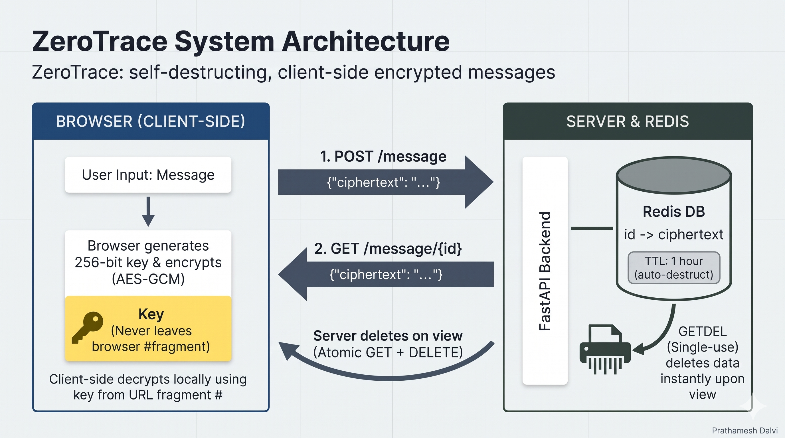

# ZeroTrace: self-destructing, client-side encrypted messages

A small web app for sharing a message once. The message is encrypted in your browser, the server stores only ciphertext, and the key never leaves the link.

**Live Link:** https://zerotrace.buildwithpaddy.dev (free tier: the first request after idle can take up to a minute)



## How it works

1. You type a message and pick an expiry (5 minutes, 1 hour or 24 hours). The browser generates a random 256-bit key and encrypts the message with **AES-GCM** (WebCrypto API).
2. Only the ciphertext is sent to the server and stored in **Redis** with a time limit.
3. You get a link like `/view.html?id=<id>#<key>`. The key sits after `#`, so browsers never send it to the server.
4. The receiver opens the link and clicks **Reveal**. The browser fetches the ciphertext, the server deletes it in the same step (atomic GET + DELETE), and the browser decrypts it locally.
5. Opening the link again returns "not found". So does opening it after the expiry time.

The Reveal button is deliberate: link-preview bots (Slack, WhatsApp) open links automatically, and fetching on page load would burn the message before the real recipient sees it.

## Security features

| Layer | What it does | Attack it addresses |
|---|---|---|
| Client-side AES-GCM | Server only ever sees ciphertext; key stays in the URL fragment | Database leak, curious server operator |
| View-once (atomic GET + DELETE) | Message is deleted the moment it is read | Replay, message lingering after delivery |
| Redis TTL | Every message expires on its own (60 s to 24 h) | Old messages piling up |
| Expiry validation | `expiry_time` must be between 60 and 86400 seconds | Storage abuse with a huge or invalid expiry |
| Input limits | Ciphertext must be 1 to 20000 characters | Oversized or empty payloads |
| Rate limiting (slowapi + Redis) | `POST /message` 10/min and `GET /message/{id}` 15/min per client IP | Flooding, ID brute-forcing |
| 128-bit random IDs | `secrets.token_urlsafe(16)` | Guessing message IDs |
| Content-Security-Policy | Only same-origin scripts, styles, images and requests; no framing | XSS, key theft via injected scripts, clickjacking |
| Other headers | `X-Frame-Options: DENY`, `X-Content-Type-Options: nosniff`, `Referrer-Policy: no-referrer`, `Cache-Control: no-store` on `/message` | Clickjacking, MIME sniffing, ID leaking through Referer, caching of ciphertext |
| HSTS | Sent only when `APP_ENV=production` | Downgrade to plain HTTP |
| CORS | Off by default (frontend is served by the same app) | Cross-origin calls from other sites |
| Container | Runs as non-root user, Redis is not exposed outside the compose network | Container escape impact, direct Redis access |

The frontend has no inline scripts or styles and no third-party resources, which is what lets the strict CSP work. A test checks this.

## Run it

**Docker (recommended):**

```bash
cp backend/.env.example backend/.env   # fill in the values, see Configuration
docker compose up --build
```

Then open http://localhost:8000.

**Local development:**

```bash
python -m venv myenv && source myenv/bin/activate
pip install -r requirements.txt
cp backend/.env.example backend/.env
# Redis must be running on localhost:6379
cd backend && uvicorn app.main:app --reload
```

## API

| Method | Path | Body | Response |
|---|---|---|---|
| POST | `/message` | `{"ciphertext": "<string, 1 to 20000 chars>", "expiry_time": <seconds, 60 to 86400, default 3600>}` | `{"id": "<id>"}` |
| GET | `/message/{id}` | | `{"ciphertext": "..."}` or `404` |
| GET | `/health` | | `{"message": "all ok"}` |

Status codes: `422` for invalid input, `429` when the rate limit is hit, `404` for unknown, expired or already-read messages.

## Project structure

```
backend/app/
  main.py            app setup, routers, middleware, static frontend
  db.py              Redis connection (messages)
  core/
    config.py        settings from environment / .env
    cors.py          CORS setup
    CSP.py           security headers middleware
    rate_limiter.py  slowapi limiter and 429 handler
  routes/            HTTP layer only
  schemas/           request validation (Pydantic)
  services/          Redis logic
backend/tests/       pytest suite
frontend/            plain HTML, CSS and JS (no framework, no third-party scripts)
```

Routes never talk to Redis directly and services know nothing about HTTP.

## Configuration

Settings come from environment variables or `backend/.env` (see `backend/.env.example`). Variable names must match exactly.

| Variable | Meaning | Default |
|---|---|---|
| `REDIS_HOST`, `REDIS_PORT`, `REDIS_PASSWORD` | Redis for stored messages | `localhost`, `6379`, empty |
| `RATE_LIMITER_REDIS_URL` | Where rate-limit counters live, e.g. `redis://redis:6379/1` | **required** |
| `APP_ENV` | Set to `production` to enable HSTS | `development` |
| `MSG_TTL_SECONDS` | Default expiry when the client sends none | `3600` |
| `MAX_MSG_LENGTH` | Max ciphertext length | `20000` |
| `CORS_ORIGINS` | JSON list, e.g. `["https://example.com"]` | `[]` |

Messages use Redis DB 0 and the rate limiter uses DB 1. In Docker Compose, `docker-compose.yml` overrides `REDIS_HOST` and `RATE_LIMITER_REDIS_URL` so the app talks to the `redis` container, because `localhost` inside a container means the container itself.

Never commit `backend/.env`. It is in `.gitignore` and `.dockerignore`.

### Behind a reverse proxy

Rate limiting is per client IP. On most hosting platforms the app sits behind a proxy, and uvicorn only trusts `X-Forwarded-For` from localhost by default. Without telling uvicorn to trust the platform proxy (`--proxy-headers --forwarded-allow-ips`), every user would look like the same IP and share one rate limit. Only do this when the app is reachable solely through the platform's proxy, otherwise clients can spoof their IP.

## Deployment

Deployed on Render as a Docker web service, with a Render Key Value (Redis-compatible) instance in the same region on a private network. The app serves the frontend itself, so there is one service and no CORS. Environment variables set on Render: `APP_ENV=production`, `REDIS_HOST`, `REDIS_PORT`, `RATE_LIMITER_REDIS_URL`. In production the API docs (`/docs`, `/openapi.json`) are disabled and HSTS is sent.

Notes on the free tier: the service sleeps after 15 minutes without traffic, and the Key Value instance is in-memory only, so a restart drops any unread messages. This fits a temporary-message app, but it is not a durable store.

## Tests

```bash
cd backend && pytest -v
```

Tests use an in-memory fake Redis and an in-memory rate limiter, so no server or Docker is needed. 58 tests run by default (plus one slow test, see below).

| File | What it checks |
|---|---|
| `test_messages.py` | Create, read once, 404 for unknown id, oversize and empty input |
| `test_expiry.py` | TTL is set in Redis, default TTL, invalid or huge expiry values return 422 |
| `test_rate_limit.py` | 11th POST and 16th GET return 429, POST and GET limits are independent, spoofed `X-Forwarded-For` does not bypass the limit |
| `test_security_headers.py` | CSP contents, headers on normal, 404 and 429 responses, HSTS only in production, no inline code in the frontend |
| `test_attacks.py` | View-once, ID length and uniqueness, malformed bodies, hostile ids (`../`, `*`, SQL-like, script tags), CORS from an unknown origin, API docs hidden in production |

One slow test waits 61 seconds to confirm a message really expires. It is skipped by default:

```bash
RUN_SLOW=1 pytest -k really_expires
```

`test_docs_hidden_in_production` confirms the API docs return 404 when `APP_ENV=production`.

## Threat model and limitations

What it protects against: someone reading stored data (a database leak shows only ciphertext), the message lingering after it is read, and basic flooding and injection attempts against the API.

What it does not do:

- **You still trust the JavaScript the server sends.** A compromised server could ship code that steals the key. Strict CSP and no third-party scripts reduce this but do not remove it. This is the main limit of any browser-based end-to-end encryption.
- **The server sees metadata**: IP address, message size and timing. This is not full anonymity.
- **Anyone with the full link can read the message once.** Share it over a channel you trust.
- **Anyone who learns only the message id (not the key) can burn the message** by requesting it. The id is 128 bits and requests are rate limited, but the message cannot be recovered once burned.
- Redis may write data to disk depending on its configuration, so "deleted" is not forensic-grade.
- No authentication or abuse reporting. Rate limiting is per IP, so many clients behind one shared IP share a limit.
- Text messages only.

## Roadmap

- **v2:** rate limiting, security headers (CSP), expiry validation, automated security tests and HTTPS deployment are done. Still to come: a self-attack write-up and Redis hardening beyond the defaults.
- **v3:** encrypted file sharing, audit logging, password-protected links

## Built by

Prathamesh Dalvi. Feedback and attack ideas are welcome via issues.